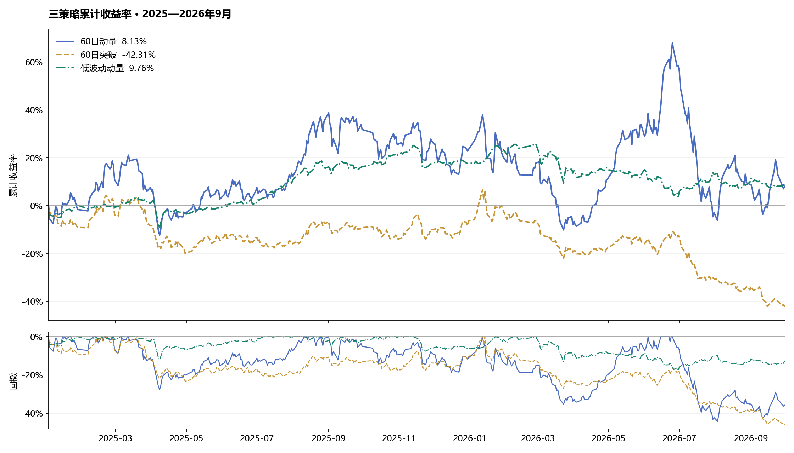
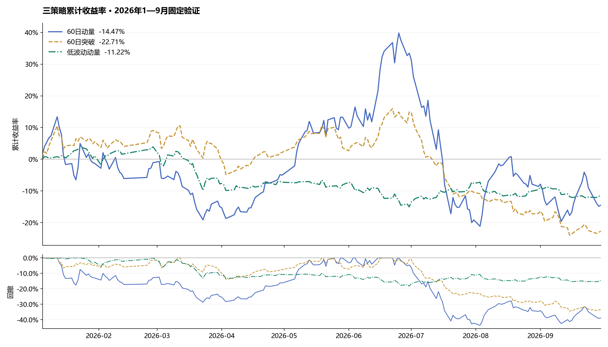
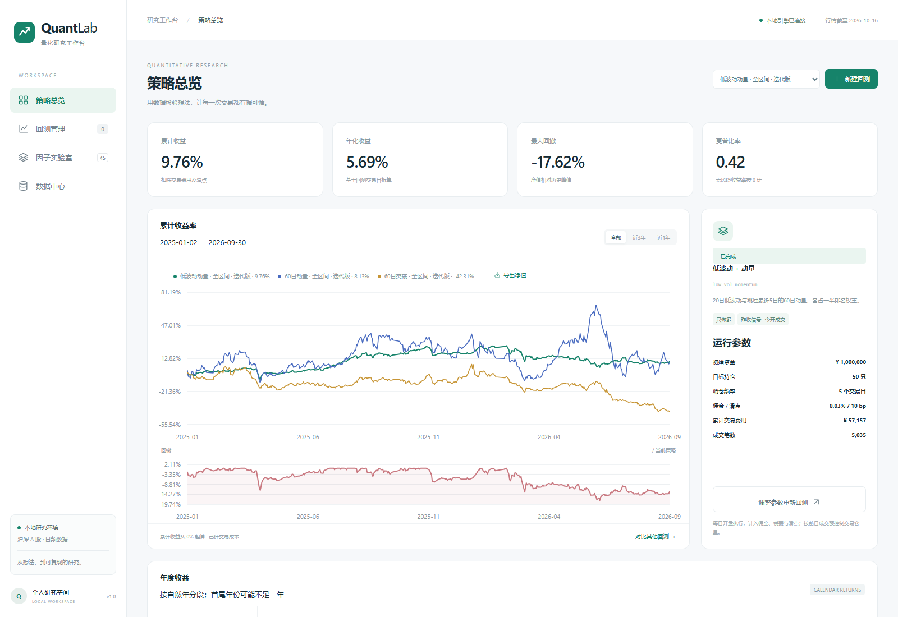
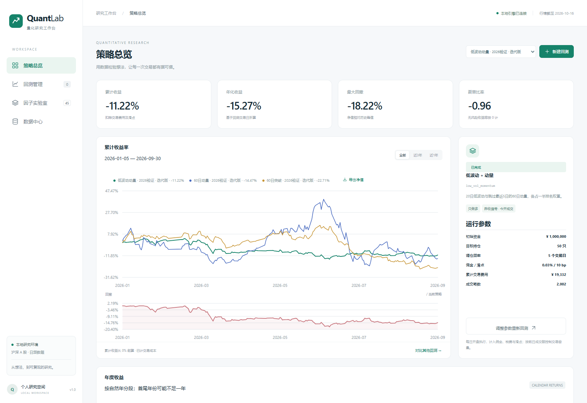
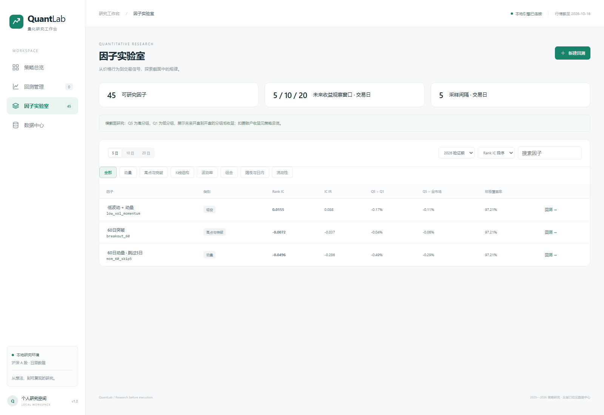

# QuantLab 三策略研究成果

完成 A 股日频研究平台搭建与项目整理，贯通参数配置、异步执行、曲线对比、因子分析和结果导出。使用本地 feathers 行情，研究区间为 2025-01-01 至 2026-09-30，共 424 个交易日、5,451 只股票。

## 平台成果

- 统一启动入口与数据目录配置，集中到单一启动命令。
- 按引擎、信号库、实验编排、API、任务队列和静态前端划分职责。
- 完成 12 组开发参数实验与 9 组全区间/验证账户结果。
- 开发参数、冻结配置、交易流水、净值、指标和截图统一归档。

## 策略迭代

固定初始版为 50 只持仓、每 5 个交易日调仓。开发期为 2025 年，候选网格为持仓数 30/50、调仓间隔 5/10；按开发期扣费夏普选择参数，冻结后执行验证。

| 策略 | 初始版开发收益 | 迭代版开发收益 | 选中持仓数 | 调仓间隔 |
| --- | ---: | ---: | ---: | ---: |
| 60日动量 | 11.73% | 23.59% | 30 | 5 日 |
| 60日突破 | -39.21% | -6.25% | 50 | 10 日 |
| 低波动动量 | 17.78% | 17.78% | 50 | 5 日 |

动量策略将持仓集中至 30 只；突破策略将调仓间隔延长至 10 日；低波动动量在候选网格中保留原参数。

## 全区间结果

2025-01-02 至 2026-09-30，初始资金 100 万元，计入佣金、税费和单边 10bp 滑点。

| 策略 | 累计收益 | 年化收益 | 最大回撤 | 夏普 | 期末资产 |
| --- | ---: | ---: | ---: | ---: | ---: |
| 60日动量 | 8.13% | 4.75% | -44.13% | 0.327 | 1,081,257.07 元 |
| 60日突破 | -42.31% | -27.88% | -45.92% | -1.051 | 576,944.77 元 |
| 低波动动量 | 9.76% | 5.69% | -17.62% | 0.422 | 1,097,606.30 元 |

低波动动量取得全区间 9.76% 累计收益，最大回撤为 17.62%；60 日动量累计收益为 8.13%。

## 固定验证结果

2026-01-05 至 2026-09-30，各方案单独从 100 万元启动账户。验证成绩保留原始结果，参数不根据验证结果再次选择。

| 策略 | 初始版收益 | 迭代版收益 | 收益变化 | 迭代版最大回撤 |
| --- | ---: | ---: | ---: | ---: |
| 60日动量 | -4.51% | -14.47% | -9.95 个百分点 | -43.61% |
| 60日突破 | -29.66% | -22.71% | +6.94 个百分点 | -34.43% |
| 低波动动量 | -11.22% | -11.22% | +0.00 个百分点 | -18.22% |

突破策略在固定验证期相对初始版提高收益 6.94 个百分点，交易费用由 29,382.36 元降至 16,351.88 元。

## 工作台截图

## 复现与成果文件

运行命令与目录结构见 [项目首页](../README.md)。账户交易口径和指标公式见 [计算说明](../docs/execution.md)。

- [开发期参数全表](development_grid.csv)
- [冻结参数](selected_parameters.json)
- [策略结果汇总](strategy_summary.csv)
- [行情文件指纹](data_manifest.json)
- [独立指标与资金对账](reconciliation.json)
- [浏览器操作记录](browser_acceptance.json)

研究采用昨收信号、次日开盘执行、只做多、等权目标配置、前日成交额容量限制和复权总收益等价持股记账。
